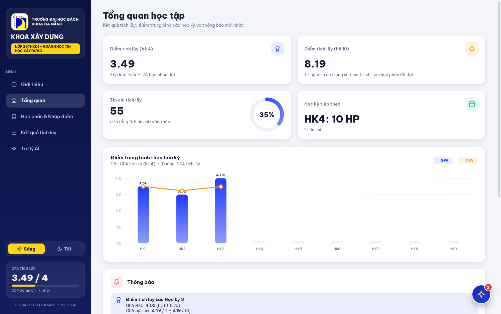
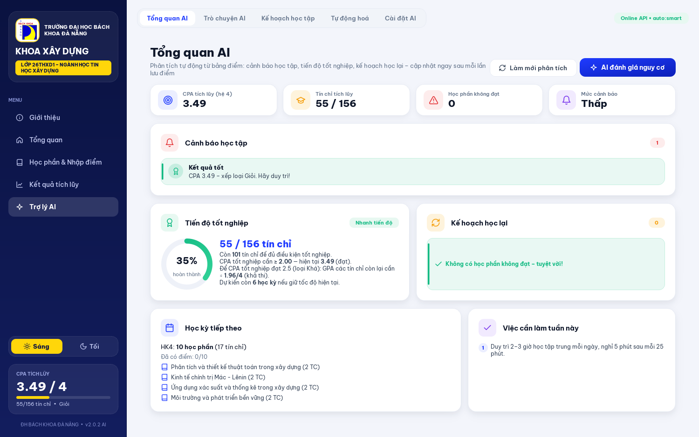
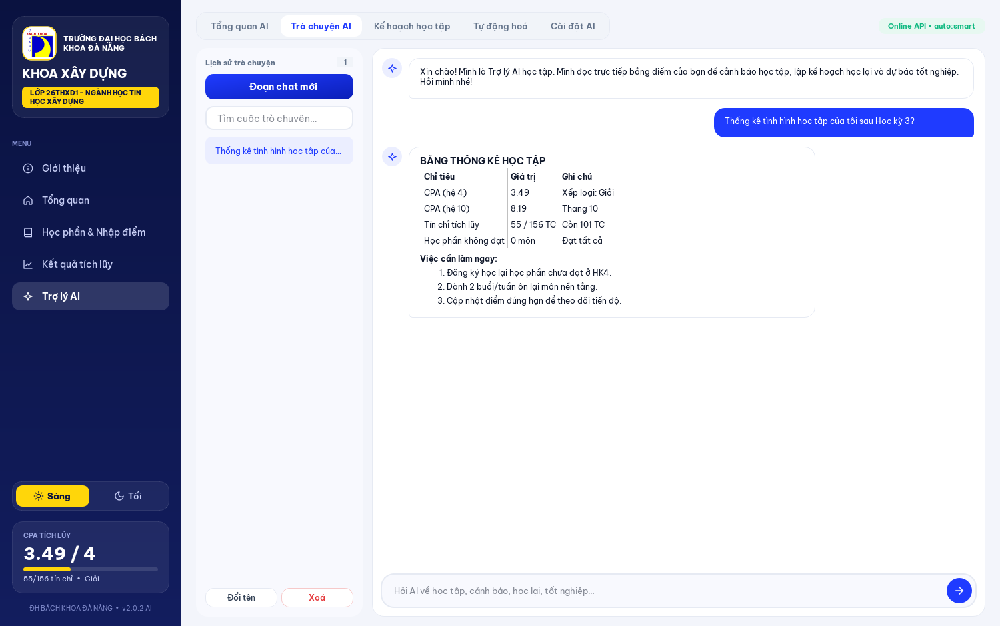
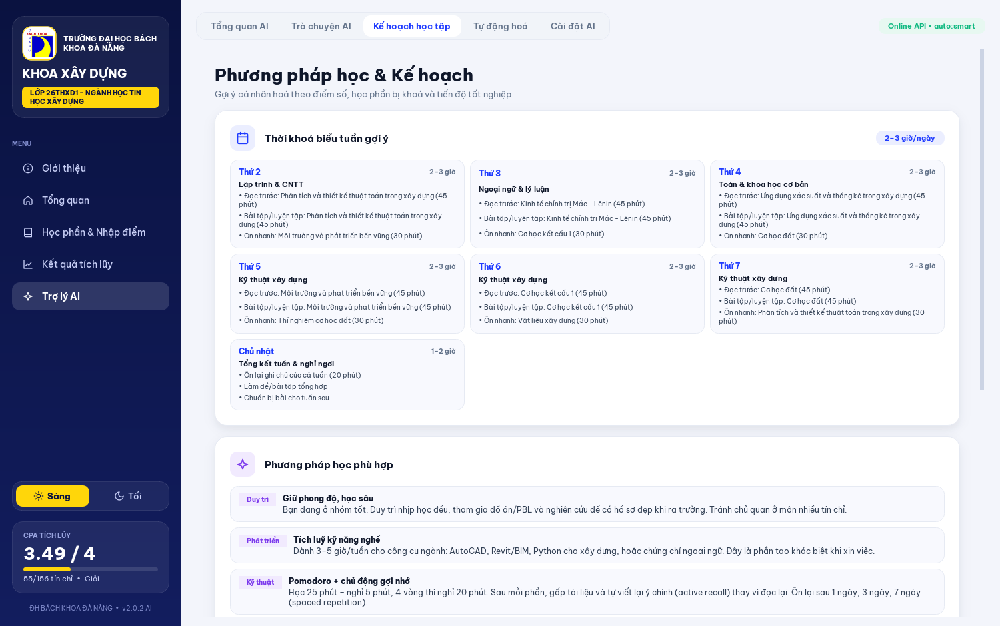
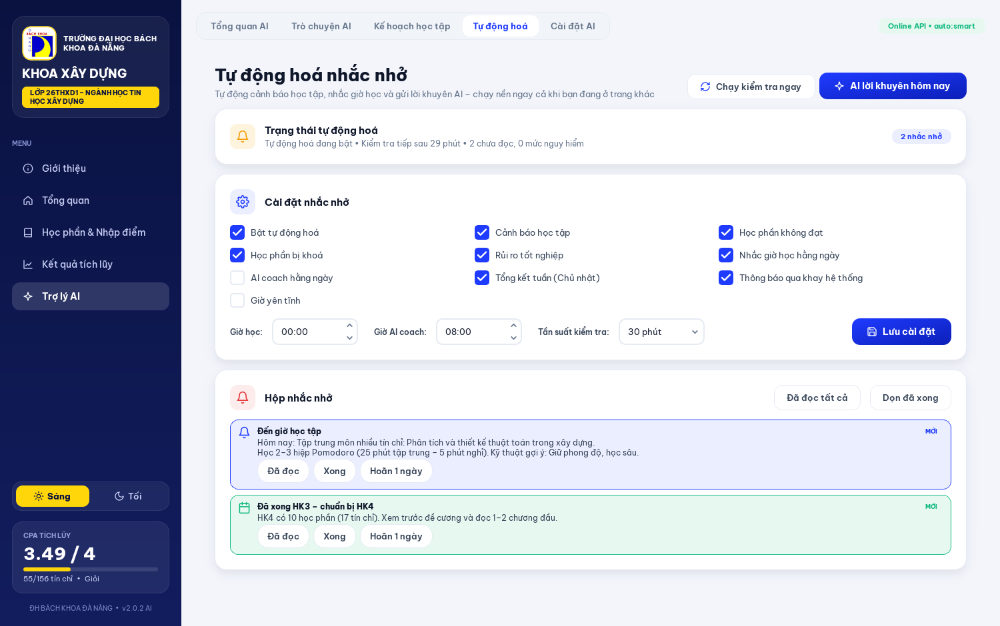
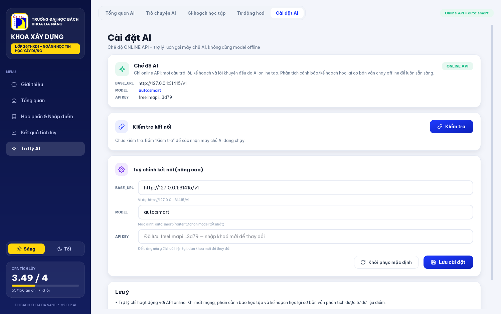
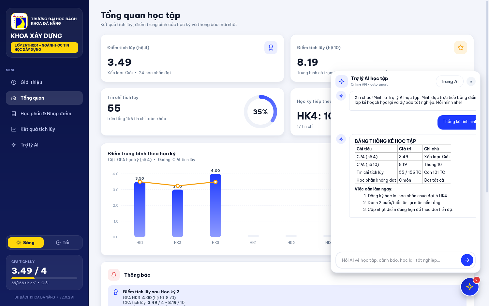
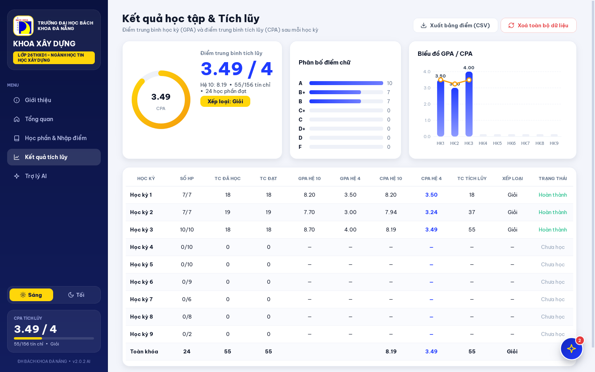

# Quản lý Học phần – Tin học Xây dựng (DUT) + Trợ lý AI

<p align="left">
  
  
  
  
  
</p>

Ứng dụng desktop viết bằng **Python + PySide6**, quản lý toàn bộ chương trình đào tạo ngành **Tin học Xây dựng**
(Trường Đại học Bách khoa – ĐH Đà Nẵng, mã ngành 7580201): **79 học phần / 9 học kỳ / 156 tín chỉ**, nhập điểm,
tính GPA – CPA, kiểm tra học phần tiên quyết, đối chiếu **quy chế đào tạo thật của Trường** và tích hợp
**Trợ lý AI online** trả lời có căn cứ điều – khoản.

> Đồ án môn học: *“Xây dựng phần mềm Quản lý Học phần và Trợ lý AI học tập cho sinh viên ngành Tin học Xây dựng”*
> — GV hướng dẫn: **Nguyễn Thanh Hải**.

---

## 1. Ảnh chụp màn hình

| Tổng quan & bảng điểm | Trợ lý AI – Tổng quan |
|---|---|
|  |  |

| Trò chuyện AI (có trích quy chế) | Kế hoạch & phương pháp |
|---|---|
|  |  |

| Tự động hoá nhắc nhở | Cài đặt AI |
|---|---|
|  |  |

| Bong bóng chat nổi | Kết quả tích luỹ |
|---|---|
|  |  |

---

## 2. Tính năng chính

### 2.1. Quản lý học phần & điểm
- Danh sách **79 học phần** theo 9 học kỳ, tìm kiếm toàn chương trình, xem mô tả tóm tắt từng học phần.
- Phân loại học phần: Lý thuyết / Đồ án / PBL / Thực hành – Thí nghiệm / Thực tập.
- Nhập **Thành phần – Giữa kỳ – Cuối kỳ** → điểm tổng = 20% + 20% + 60%, quy đổi điểm chữ và hệ 4.
- **Ràng buộc tiên quyết**: chặn lưu điểm khi chưa đạt học phần học trước; cảnh báo học phần song hành.
- **GPA học kỳ, CPA tích luỹ, tín chỉ tích luỹ, xếp loại**, biểu đồ tiến độ, xuất CSV.
- CPA tính trên *tất cả học phần đã có điểm* (kể cả không đạt); tín chỉ tích luỹ chỉ cộng học phần đạt.

### 2.2. Trợ lý AI (chỉ ONLINE API)
- **Tổng quan AI**: cảnh báo học tập theo quy chế, kế hoạch học lại ưu tiên môn “mở khoá” nhiều môn sau,
  tiến độ tốt nghiệp, mức GPA cần đạt cho CPA 2.0 / 2.5 / 3.2, việc cần làm trong tuần.
- **Trò chuyện AI**: chat với toàn bộ ngữ cảnh bảng điểm; render Markdown đầy đủ (bảng, tiêu đề, danh sách, code).
- **Lịch sử trò chuyện**: lưu bền theo phiên, tự đặt tên theo câu hỏi đầu, tìm kiếm / đổi tên / xoá,
  chuyển phiên là khung chat vẽ lại đúng nội dung cũ.
- **Thẻ “Quy chế & chuẩn đầu ra”**: chip trạng thái, checklist 4 điều kiện tốt nghiệp, mức học bổng,
  đánh dấu đã có chứng chỉ ngoại ngữ / CNTT (lưu vào hồ sơ cá nhân).
- **Tự động hoá**: nhắc giờ học hằng ngày, cảnh báo học tập, học phần bị khoá, rủi ro tốt nghiệp,
  tổng kết tuần, “AI coach” mỗi ngày; hộp nhắc nhở có đọc / xong / hoãn; thông báo qua khay hệ thống.
- **Bong bóng chat nổi** ở góc dưới-phải kèm badge nhắc nhở chưa đọc, mở chat nhanh ở mọi trang.

### 2.3. Trả lời “đúng luật”, có căn cứ
- Nhúng **6 văn bản quy chế** của Trường (`app/assets/luat/`), gồm QĐ 2244/2021, 4511/2022, 417/2016,
  029/2017 + 1274/2019, 1414/2021.
- Trước khi gọi AI, hệ thống **chọn đoạn quy chế liên quan** bằng IDF + cụm 2 từ + ưu tiên tiêu đề mục,
  lấy đoạn khớp nhất của mỗi văn bản rồi chèn vào ngữ cảnh → câu trả lời luôn nêu **điều – khoản**.
- Prompt hệ thống bắt buộc: nêu căn cứ, xử lý câu hỏi giả định (“nếu em bị F môn …”), không viết quá trình suy nghĩ.
- Bộ luật thuần Python (không phụ thuộc AI) cho các kết luận tất định: cảnh báo học tập (Điều 12),
  giới hạn tín chỉ đăng ký, mức học bổng, điều kiện làm đồ án tốt nghiệp, điều kiện tốt nghiệp.

---

## 3. Kiến trúc & cấu trúc thư mục

```
app_src/
├── app/
│   ├── main.py            # Điểm vào, MainWindow, điều hướng, theme
│   ├── core.py            # Mô hình dữ liệu: học phần, điểm, GPA/CPA, lưu trữ
│   ├── courses_data.py    # 79 học phần / 9 học kỳ / 156 TC (dữ liệu chương trình)
│   ├── rules.py           # Quy chế: cảnh báo, tín chỉ, học bổng, tốt nghiệp + trích tài liệu
│   ├── ai_engine.py       # AIClient (OpenAI-compatible), LocalAnalytics, prompt, compliance
│   ├── ai_page.py         # Trang Trợ lý AI: tổng quan, chat, kế hoạch, tự động hoá, cài đặt
│   ├── automation.py      # Scheduler nhắc nhở, thông báo, AI coach
│   ├── ui_kit.py          # Widget, font, màu, icon dùng chung
│   └── assets/
│       ├── luat/          # 6 văn bản quy chế (trích điều – khoản)
│       ├── fonts/ icons/ logo_*  members/
├── tools/                 # Script dựng video demo / chụp ảnh (dùng ffmpeg, Qt offscreen)
├── tests_core.py          # Kiểm thử lõi tính điểm, GPA/CPA, lưu trữ
├── tests_rules.py         # 45 kiểm thử bộ luật quy chế
├── tests_cases.py         # 56 tình huống hỏi–đáp (48 offline + 8 gọi AI thật)
├── tests_chat_ui.py       # 35 kiểm thử đi qua chính khung chat của app
├── tests_ai.py            # Cấu hình AI, phân tích, dựng prompt
├── tests_automation.py    # Nhắc nhở, scheduler
├── tests_gui.py           # Khởi tạo giao diện, điều hướng
├── TinHocXayDung.spec     # Cấu hình PyInstaller (onefile)
├── build_windows.bat      # Đóng gói .exe trên Windows
├── requirements.txt
└── docs/screenshots/      # Ảnh dùng trong README
```

**Luồng xử lý một câu hỏi trong khung chat**

```
người dùng gõ câu hỏi
        │
        ▼
ChatSession.send()  ──►  ai_engine.build_messages("qa", …)
        │                   ├── hồ sơ + bảng điểm (LocalAnalytics.report)
        │                   ├── bản đồ học phần tiên quyết
        │                   └── rules.doc_snippets(câu hỏi)  ← trích quy chế liên quan
        ▼
AIClient.chat()  ──►  POST /chat/completions (OpenAI-compatible)
        ▼
Markdown render → bong bóng chat → lưu lịch sử phiên
```

---

## 4. Cài đặt & chạy

Yêu cầu: **Python 3.10+**, Windows 10/11 (chạy được trên Linux/macOS nếu có driver Qt).

```bash
git clone https://github.com/duykhangdangzn1/quan-ly-hoc-phan-tin-hoc-xay-dung-ai.git
cd quan-ly-hoc-phan-tin-hoc-xay-dung-ai

python -m venv .venv
.venv\Scripts\activate          # Windows
pip install -r requirements.txt

python app/main.py
```

---

## 5. Cấu hình AI (quan trọng: **không commit khoá API**)

Mã nguồn **không chứa API key**. Khoá được đọc theo thứ tự:

1. Biến môi trường `AI_API_KEY` (hoặc `OPENAI_API_KEY`)
2. Tệp cục bộ `%APPDATA%\TinHocXayDung\api.key` (một dòng chứa khoá)
3. Dán trực tiếp trong app: **Trợ lý AI → Cài đặt AI** (lưu vào `ai_config.json` trên máy)

```powershell
# Windows PowerShell
setx AI_API_KEY "khoá-của-bạn"
```

```bash
# Linux / macOS
export AI_API_KEY="khoá-của-bạn"
```

Cấu hình mặc định (đổi được trong tab *Cài đặt AI*):

```
BASE_URL = http://127.0.0.1:31415/v1     # endpoint OpenAI-compatible bất kỳ
MODEL    = auto:smart
API_KEY  = (đọc từ biến môi trường / api.key / ô nhập trong app)
```

Mọi nội dung do AI sinh ra đều gọi API online; phần **phân tích cảnh báo, kế hoạch học lại, tiến độ tốt nghiệp
và toàn bộ bộ luật quy chế vẫn chạy offline** khi mất mạng.

Thư mục dữ liệu `%APPDATA%\TinHocXayDung\`:

| Tệp | Nội dung |
|---|---|
| `grades.json` | Bảng điểm đã nhập |
| `ai_config.json` | BASE_URL / model / API key (chỉ trên máy người dùng) |
| `api.key` | Khoá API tuỳ chọn (đã bị `.gitignore`) |
| `chat_history.json` | Lịch sử phiên chat (tối đa 100 phiên) |
| `automation.json`, `reminders.json` | Cấu hình nhắc nhở |
| `settings.json`, `student_profile.json` | Giao diện, hồ sơ cá nhân |

Ghi tệp theo kiểu atomic (`.tmp` → `replace`) để không hỏng dữ liệu khi tắt đột ngột.

---

## 6. Đóng gói thành một tệp .exe

```bash
python -m PyInstaller --noconfirm --clean TinHocXayDung.spec
# hoặc: build_windows.bat
```

Kết quả: `dist/QuanLyHocPhan_TinHocXayDung_AI.exe` (một file duy nhất, đã nhúng `app/assets` gồm cả tài liệu quy chế).

---

## 7. Kiểm thử

```bash
python tests_core.py          # lõi: điểm, GPA/CPA, lưu trữ
python tests_rules.py         # 45 kiểm thử bộ luật quy chế
python tests_cases.py         # 56 tình huống hỏi–đáp (--offline để bỏ 8 câu gọi AI)
python tests_chat_ui.py       # 35 kiểm thử gõ câu hỏi vào khung chat rồi bấm gửi
python tests_ai.py            # cấu hình AI, phân tích, prompt
python tests_automation.py    # nhắc nhở, scheduler
python tests_gui.py           # khởi tạo giao diện, điều hướng
```

Bộ kiểm thử không dùng framework ngoài: mỗi `check()` in `OK/FAIL` và trả mã thoát khác 0 khi có lỗi,
nên chạy được trong CI hoặc trong script chấm tự động.

`tests_cases.py` phủ các nhóm: học phần tiên quyết, cảnh báo học tập (Điều 12), giới hạn tín chỉ,
chuẩn ngoại ngữ – CNTT, điều kiện đồ án tốt nghiệp, học bổng, liêm chính học thuật, tiến độ tốt nghiệp.

---

## 8. Bộ quy chế được nhúng

| Văn bản | Nội dung dùng trong app |
|---|---|
| QĐ 2244/2021/QĐ-ĐHBK | Đào tạo theo học chế tín chỉ: cảnh báo học tập, tốt nghiệp, đồ án |
| QĐ 4511/2022/QĐ-ĐHBK | Chuẩn ngoại ngữ / tin học; điều kiện xét tốt nghiệp |
| QĐ 417/2016/QĐ-ĐHBK | Chuẩn kỹ năng CNTT (IU01–IU06) |
| QĐ 029/2017/QĐ-ĐHBK (+1274/2019) | Liêm chính học thuật, xử lý đạo văn / gian lận |
| QĐ 1414/2021/QĐ-ĐHBK | Học bổng khuyến khích học tập (loại A / B / C) |

Nội dung được trích lại đúng điều – khoản (bản gõ tay từ văn bản gốc của Trường) và lưu dạng văn bản thuần
trong `app/assets/luat/`, nên có thể cập nhật khi Trường ban hành quy chế mới mà không cần sửa mã.

---

## 9. Nhóm thực hiện

| Thành viên | Vai trò |
|---|---|
| **Đặng Duy Khang** | Kiến trúc ứng dụng, lõi tính điểm, bộ luật quy chế, tích hợp AI, kiểm thử |
| Trần Bảo Khang | Dữ liệu chương trình đào tạo, giao diện |
| Đỗ Chí Kiên | Trợ lý AI, nội dung quy chế |
| Đỗ Công Tuấn Anh | Tự động hoá, kiểm thử, tài liệu |

GV hướng dẫn: **Nguyễn Thanh Hải** — Trường Đại học Bách khoa, ĐH Đà Nẵng.

## 10. Script dựng video demo (tuỳ chọn)

Thư mục `tools/` chứa các script dựng video giới thiệu bằng Qt offscreen + ffmpeg + TTS cục bộ
(`make_intro_video.py`, `make_demo_video.py`, `make_chat_video.py` — quay chính app, gõ câu hỏi vào khung chat
rồi gửi cho AI). Hai tài nguyên nặng được **.gitignore** và cần tải riêng nếu muốn chạy lại:

- `tools/piper_voices/` — model TTS Piper `vi_VN-vais1000-medium.onnx` (~61 MB)
- `tools/luat_txt/` — ảnh scan văn bản quy chế dùng khi gõ lại tài liệu

Không có hai thư mục này, app và toàn bộ bộ kiểm thử vẫn chạy bình thường.

## 11. Ghi chú

- Dự án phục vụ mục đích học tập; dữ liệu điểm và hồ sơ chỉ lưu trên máy người dùng.
- Không có khoá API, token hay thông tin đăng nhập nào trong repository.
- Chạy `git status` trước khi commit để chắc chắn `.env` / `api.key` / `*.exe` không bị đưa lên.
